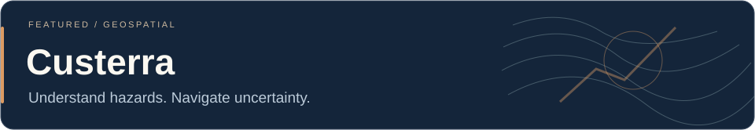
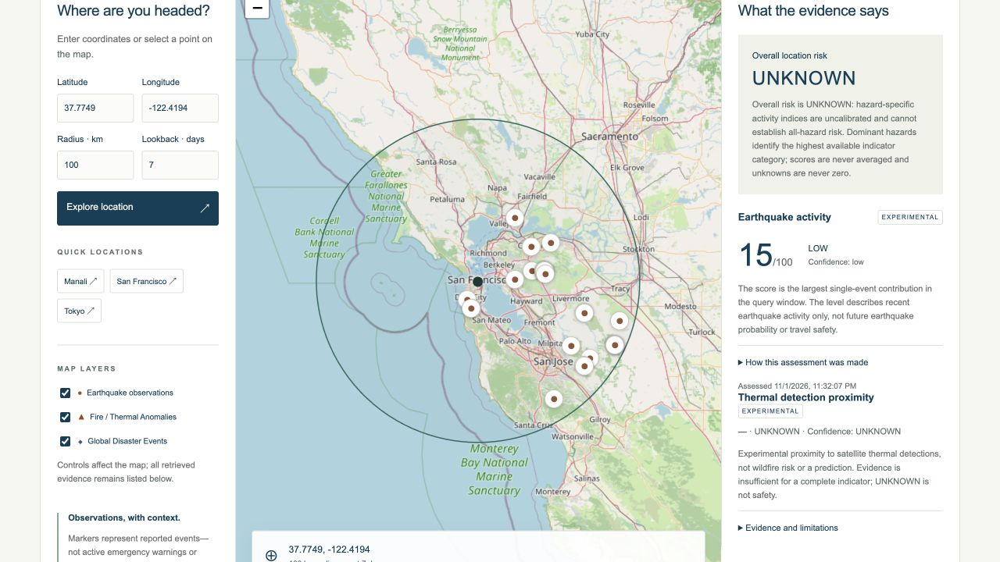
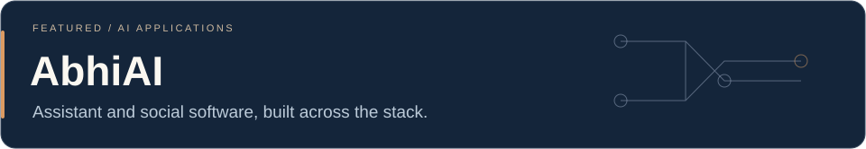
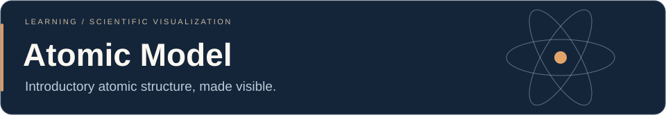

<picture>
  <source media="(prefers-reduced-motion: reduce)" srcset="assets/header-static.svg">
  
</picture>

I’m **Abhishek**, a computer science undergraduate building backend services, full-stack applications and tools for exploring data. I like working across the API, data model and interface—and understanding what happens when a system fails.

[Projects](#featured-projects) · [Languages & tools](#languages--tools) · [Current focus](#research--current-focus) · [Connect](#connect) · [Static header](assets/header-static.svg)

## Languages & tools

Technologies used in my projects, grouped by the work they support.

**Languages**

     

**Backend & data**

   

**Frontend**

  

**Delivery & research**

     

I use JUnit, Vitest, Playwright and pytest for verification, and Render for hosted previews. My scientific Python work is experimental; I do not treat a prototype score as a validated real-world prediction.

## Featured projects

### Custerra

A geospatial natural-hazard application for exploring reported observations, location context and route exposure. My work spans the Java API, map interface, persistence, journey workflows and verification.

**Java · Spring Boot · PostgreSQL · Next.js · TypeScript · Leaflet**

**State:** V2 release preparation; source remains private until publication checks pass. The [staging preview](https://custerra-v2-staging.onrender.com) uses free hosting and can sleep; background monitoring and outbound push are disabled. It is not an official warning service or a validated disaster forecast.

[Staging preview](https://custerra-v2-staging.onrender.com) · Source publication pending the safety checks.

See the actual Custerra staging map

Staging preview using public test coordinates. Earthquake evidence: [USGS](https://earthquake.usgs.gov/fdsnws/event/1/). Map data © [OpenStreetMap contributors](https://www.openstreetmap.org/copyright).

### AbhiAI

An AI assistant and social application with a Java backend and a Next.js web client. I’m working on provider routing, streaming conversations, persistence and clear client/server boundaries.

**Java · Spring Boot · PostgreSQL · Next.js · React · TypeScript**

**State:** active development. Provider availability and product reliability are ongoing engineering work.

[Backend](https://github.com/Ap-95671/abhiai-backend) · [Web client](https://github.com/Ap-95671/abhiai-frontend) · [Development roadmap](https://github.com/users/Ap-95671/projects/2)

### Atomic Model

A smaller **Python / Pygame** learning project that visualizes hydrogen, helium and lithium, with introductory Bohr-model calculations for hydrogen. The visual model is educational; it does not simulate multi-electron quantum mechanics.

[Repository](https://github.com/Ap-95671/atomic-model)

## Research & current focus

I’m interested in **software architecture, AI applications, geospatial computing and system reliability**. I’m developing these interests through project work and study.

- **Building:** Custerra’s release readiness and AbhiAI’s assistant/social workflows.
- **Exploring:** reproducible evaluation, geographic/time holdouts and honest uncertainty.
- **Improving:** API contracts, failure behavior, tests and technical documentation.

My environmental-classification experiments remain research-only. No publication, accepted paper or granted patent is claimed here.

## GitHub activity

<picture>
  <source media="(prefers-reduced-motion: reduce)" srcset="assets/activity/calendar-static.svg">
  <source media="(prefers-color-scheme: dark)" srcset="assets/activity/contribution-snake-dark.svg">
  
</picture>

[Static calendar](assets/activity/calendar-static.svg) · [GitHub activity](https://github.com/Ap-95671?tab=overview) · [Refresh workflow](https://github.com/Ap-95671/Ap-95671/actions/workflows/contribution-visuals.yml)

Updated weekly from GitHub’s contribution calendar. The static snapshot records the generated date and reported count.

The portfolio focuses on the systems above. Contribution counts describe GitHub activity, rather than proficiency or a ranking.

## Connect

 [GitHub](https://github.com/Ap-95671) · [LinkedIn](https://www.linkedin.com/in/abhishek-prajapati-a05252254/)

Custom local SVG artwork; no remote statistics-card service. Technology marks belong to their owners. [Asset credits and animation maintenance](ASSETS.md).
